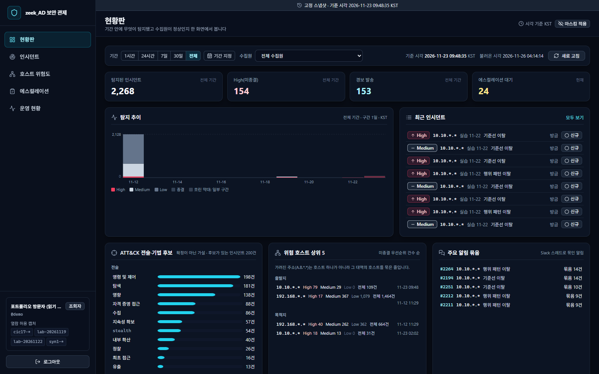
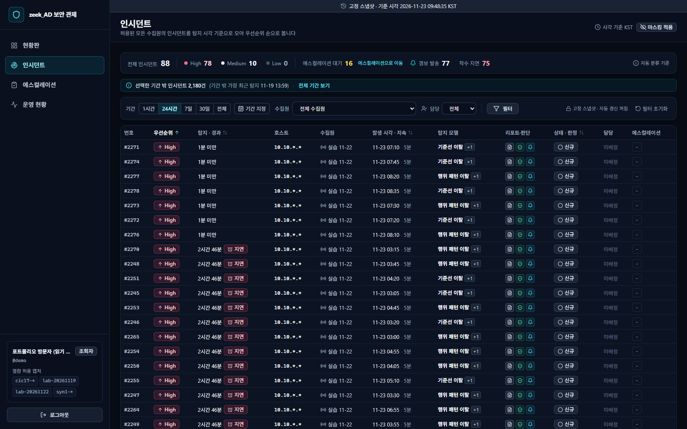
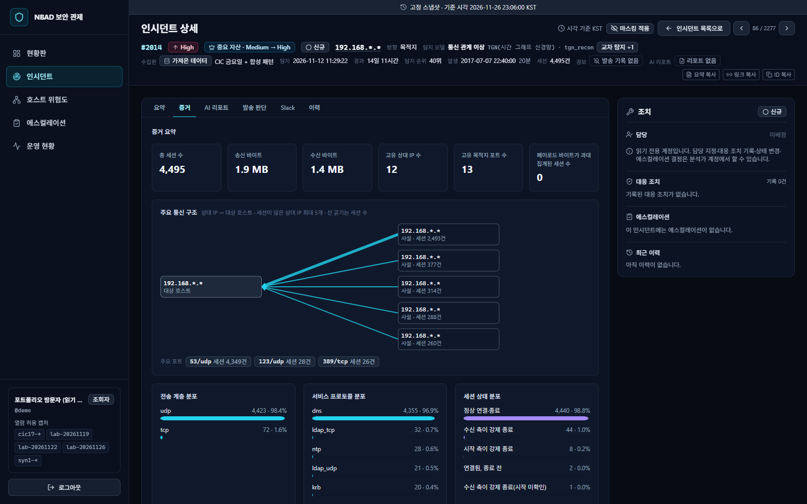
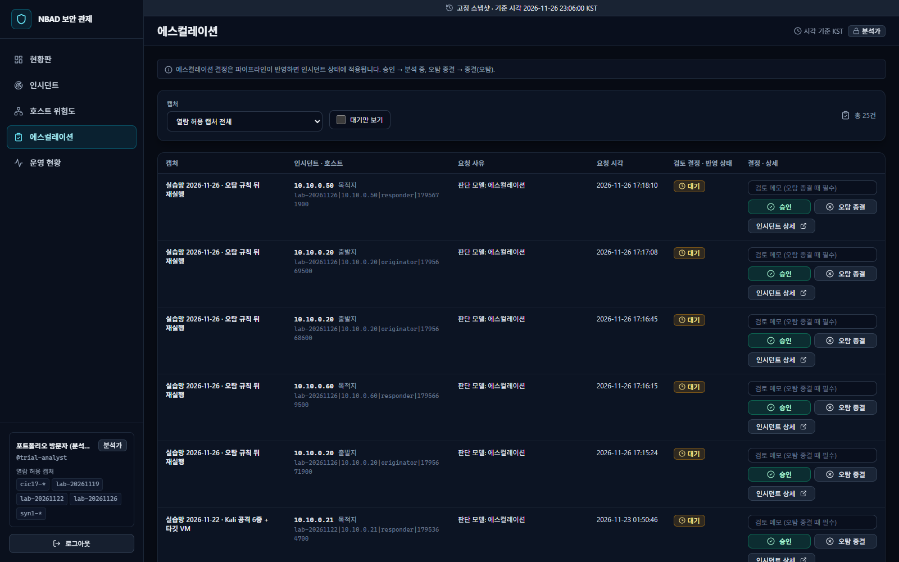
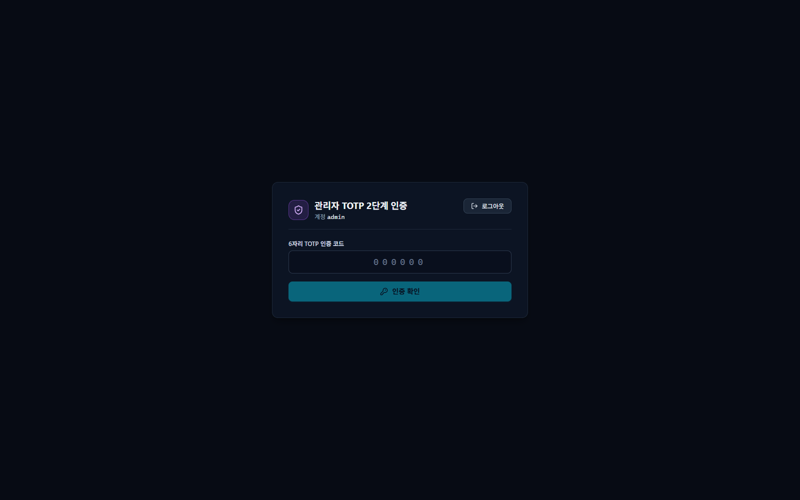
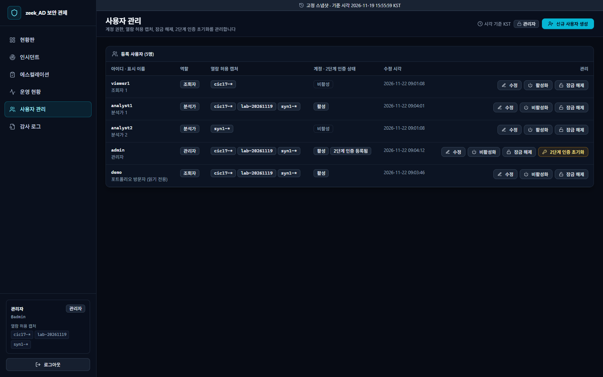

# zeek_AD 보안 관제 콘솔

네트워크 이상탐지 파이프라인 [zeek_AD](https://github.com/prosild/zeek_AD)가 찾아낸 인시던트를 분석가가 조사하고 판정하는 보안 관제(SOC) 웹 콘솔입니다. 역할별 권한, 캡처 단위 접근 통제, 개인정보 마스킹, 감사 로그를 갖춘 Spring Boot + MyBatis 백엔드와 React SPA로 만들었습니다.

**공개 데모** https://soc.psdev93.synology.me · 아이디 `demo` · 비밀번호 `WTYdSaRDUfjT3jr9cAw2` (읽기 전용 조회자 계정)

이 프로젝트에서 내린 판단 몇 가지:
- 공개 데모는 쓰기 권한을 열지 않고 읽기 전용 계정 하나만 열었습니다. 분석가·관리자 흐름은 아래 그림으로 보여 드립니다. → [판단 1](docs/design-decisions.md#1-공개-데모는-읽기-전용-계정-하나만-연다-2026-11-20)
- 비밀번호를 공개한 계정은 누구나 잠글 수 있어서 그 계정만 잠금에서 빼고 IP별 속도 제한으로 막았습니다. 다른 계정의 잠금은 그대로 둡니다. → [판단 2](docs/design-decisions.md#2-비밀번호를-공개한-계정의-잠금-문제-2026-11-20-2026-11-21에-바꿈)
- 실제 데이터를 넣어 보니 자동 우선순위가 분류를 못 해서(High가 구간당 60~120건) 규칙을 다시 정했습니다. → [판단 7](docs/design-decisions.md#7-실제-데이터를-보고-우선순위-규칙을-다시-정했다-2026-11-21)

## 공개 데모 둘러보기

- 데이터는 2026-11-19 15:55:59 KST에 멈춘 고정 스냅샷입니다. 화면의 "최근 24시간"은 이 기준 시각에서 셉니다.
- `demo`는 조회자(`VIEWER`)입니다. IP는 뒤 두 옥텟이 가려지고(`10.10.*.*`), 상태 변경·담당 지정·에스컬레이션 결정은 할 수 없습니다. 볼 수 있는 캡처는 CIC-IDS2017(`cic17-*`), 합성 APT를 끼운 CIC 데이터(`syn1-*`), Kali 실습망 캡처(`lab-20261119`)입니다.
- 기본 기간(24시간)에는 실습망 인시던트 52건만 보입니다. 기간을 **전체**로 넓히면 가져온 데이터까지 2,180건이 보입니다.

처음 보실 때 권하는 순서:
1. **현황판**: 기간을 "전체"로 바꾸면 탐지 추이와 수집원 상태가 보입니다.
2. **인시던트**: 우선순위 High부터 정렬된 큐입니다. 착수 목표를 넘긴 건에는 "지연" 표지가 붙습니다.
3. 인시던트 하나를 열어 **요약 → 증적 → AI 리포트 → 발송 판단** 탭 순서로 봅니다.
4. **운영 현황**: 분석가 판정 집계, 처리 시간(MTTD·MTTA·MTTR), 탐지 작업 기록입니다.

## 무엇을 만들었나

zeek_AD는 Zeek 네트워크 로그를 여러 이상탐지 모델로 채점하고 인시던트마다 AI 분석 리포트와 경보 발송 판단을 만드는 파이프라인입니다. zeek_AD도 제가 만든 프로젝트이고 이 저장소는 그 결과를 사람이 조사하고 판정하는 쪽을 맡습니다.

- 대시보드는 zeek_AD DB를 **읽기 전용 뷰**로만 읽습니다. 쓰기는 zeek_AD가 제공하는 DB 함수 두 개(인시던트 상태 변경, 에스컬레이션 결정)를 부르는 것뿐입니다.
- 대시보드 자신의 데이터(사용자, 담당자, 인시던트 번호, 감사 로그)는 같은 PostgreSQL 안의 별도 DB에 둡니다.
- 인시던트 상세의 증적은 zeek_AD의 근거 API(FastAPI)에서 받아 백엔드가 권한 검사와 마스킹을 거친 뒤 보냅니다.


공개 데모의 구성은 [`compose.portfolio.yml`](compose.portfolio.yml)이고 VMware 실습 환경(zeek_AD와 같은 VM) 구성은 [`compose.yml`](compose.yml)입니다.

## 역할별 화면

조회자 화면은 공개 데모와 같습니다. 분석가·관리자 그림은 공개 데모와 같은 스냅샷을 복원한 로컬 스택에서, 그 스택에서만 켠 계정으로 찍었습니다.

**조회자** (공개 데모 `demo`와 같은 화면)

| 현황판 | 인시던트 큐 |
|---|---|
|  |  |



**분석가**: 인시던트를 맡고(담당 지정), 상태를 바꾸고 파이프라인이 넘긴 에스컬레이션을 승인하거나 오탐으로 종결합니다. 분석가는 IP 원문을 보고 원문 열람은 감사 로그에 남습니다.

| 인시던트 상세와 조치 패널 | 에스컬레이션 목록 |
|---|---|
|  |  |

**관리자**: 비밀번호 다음에 TOTP 2단계 인증을 거쳐야 업무 API가 열립니다. 사용자의 역할과 열람 허용 캡처를 관리하고 수정·삭제할 수 없는 감사 로그를 봅니다.

| TOTP 2단계 인증 | 사용자 관리 | 감사 로그 |
|---|---|---|
|  |  |  |

## 주요 판단

자세한 고려 안과 근거는 [주요 판단 기록](docs/design-decisions.md)에 있습니다.

| 문제 | 고른 것 | 그 대가 |
|---|---|---|
| 공개 인터넷에서 쓰기 권한을 열면 누구나 데이터를 바꾼다 | 읽기 전용 계정 하나만 공개, 쓰기 흐름은 그림으로 | 방문자가 분석가 흐름을 직접 해 볼 수 없다 |
| ZAP "Low 0" 기준과 JS가 읽어야 하는 CSRF 쿠키(HttpOnly 없음)가 충돌 | 정확히 `XSRF-TOKEN`에 대한 경고만 기계적으로 허용, 남은 위험으로 문서화 | 기준에 예외가 하나 생긴다. 규칙 전체를 끄면 다른 쿠키의 누락을 놓친다 |
| 처음 만든 서버 렌더링 화면을 직접 보니 디자인이 관제 콘솔답지 않았다 | React SPA로 바꾸되 같은 출처 세션·CSRF·엄격한 CSP·JRE 컨테이너 하나를 유지 (Next.js는 Node 런타임이 늘어 기각) | 보안 시험을 SPA 기준으로 전면 다시 썼다 |
| 대시보드가 뚫려도 파이프라인 데이터는 바뀌면 안 된다 | 같은 PostgreSQL 안의 별도 DB와 계정 셋(앱·읽기·쓰기 함수 전용) | 데이터 소스가 셋이고 새 쓰기는 zeek_AD 함수가 먼저 있어야 한다 |
| 상세 화면에 리포트 생성 정보·토큰·원본 페이로드까지 다 보였다 | 관제 판단·조치에 쓰는 정보만 남기고 용어를 관제 표준 용어로 | 파이프라인 디버깅 정보는 화면에서 바로 못 본다 |

## 보안 설계

| 통제 | 내용 | 근거 |
|---|---|---|
| 역할 기반 권한 | 조회자(읽기)·분석가(상태 변경·담당·에스컬레이션 결정)·관리자(사용자·감사 로그) | `config/SecurityConfig.java`, 시험 `TotpAndRbacIntegrationTest` |
| 객체 수준 접근 통제 | 사용자별 열람 허용 캡처 패턴을 모든 조회에서 검사. 허용 밖과 없는 대상은 같은 `403`으로 답하고 IDOR 시도로 감사 | `service/CaptureAccessService.java`, 시험 `IdorAndMaskingIntegrationTest`, `T27IncidentNoIntegrationTest` |
| 개인정보 마스킹 | 조회자에게 IP 뒤 두 옥텟, 계정 이름, 리포트 가명 대응을 가림. 분석가 이상의 원문 열람은 감사 | `service/MaskingService.java`, 시험 `MaskingServiceTest` |
| 관리자 2단계 인증 | 관리자는 TOTP 검증 전까지 업무 API가 `403` | `security/TotpEnforcementFilter.java` |
| 계정 잠금 | 5회 실패에 15분 잠금. 비밀번호를 공개한 조회자 계정만 설정으로 제외하고 IP별 로그인 속도 제한(분당 10회, 버스트 5)이 막는다 | `security/DashboardAuthenticationProvider.java`, 시험 `T29LockoutExemptIntegrationTest`, `compose.portfolio.yml` |
| 세션·CSRF | 서버 세션(유휴 30분·절대 8시간), 쿠키 `Secure; HttpOnly; SameSite=Lax`, SPA 이중 제출 CSRF | `security/SessionTimeoutFilter.java`, `security/SpaCsrfTokenRequestHandler.java`, 시험 `SecurityAuthSessionTest` |
| 응답 헤더 | CSP `script-src 'self'; style-src 'self'`(인라인 금지), `frame-ancestors 'none'`, `nosniff`, COOP·COEP·CORP | `config/SecurityConfig.java`, 시험 `SecurityHeadersAndErrorTest` |
| WAF | Nginx + ModSecurity OWASP CRS(Paranoia 1, 차단 모드). SQLi·XSS·경로 탐색 요청을 앱 앞에서 `403` | `docker/nginx-waf/`, [보안 검증 보고서](docs/security-verification-report.md) 3절 |
| 클라이언트 IP 위조 방지 | 신뢰하는 프록시 밖의 전달 헤더를 버리고 앱에는 WAF가 정한 값만 넘김 | `docker/nginx-waf/templates/includes/proxy_backend.conf.template`, E2E `[9]` |
| 감사 로그 | 로그인·원문 열람·상태 변경·권한 변경·IDOR 시도를 기록. DB 트리거가 수정·삭제를 막음 | `V1__init_dashboard_auth_audit.sql`, 시험 `AuditLogImmutabilityTest` |
| SQL 주입 방지 | MyBatis 매퍼는 `#{}` 바인딩만 쓰고 `${}`는 시험이 금지 | 시험 `StaticSecurityAndConfigTest` |
| DB 계정 분리 | 읽기 계정은 계약 뷰 `SELECT`만, 쓰기 계정은 함수 두 개 `EXECUTE`만 | [`docs/deployment-guide.md`](docs/deployment-guide.md) 2.1 |
| 컨테이너 | 비루트 실행, 최종 이미지에 Node·JDK 없음(JRE만), `cap_drop: [ALL]`, `no-new-privileges` | `Dockerfile`, `compose.portfolio.yml` |

## 검증

| 검증 | 방법 |
|---|---|
| 단위·통합·정적 보안 시험 | Gradle `check`(Spring Boot 통합 시험, MyBatis 매퍼 시험, 보안 설정 정적 검사), Vitest(화면 용어 회귀, XSS, 접근성 이름) |
| E2E | VMware 구성과 같은 PostgreSQL 17 + WAF 스택을 띄워 역할별 권한·IDOR·마스킹·WAF 차단·전달 헤더 위조를 실제 요청으로 확인 (`scripts/security-scan.ps1`) |
| 취약점·설정 스캔 | OWASP ZAP 베이스라인, Trivy(SBOM·파일 시스템·이미지), CycloneDX SBOM |
| 공개 스택 리허설 | 공개 데모와 같은 구성에 스냅샷을 복원해 E2E와 ZAP을 돌린 뒤 지운다 (`scripts/portfolio-verify.ps1`) |
| 공개 주소 확인 | 배포 뒤 공개 주소에서 로그인·마스킹·숨김 캡처 `403`·속도 제한 등을 확인 |

최근 결과(2026-11-22, commit `36a04eb`): E2E 통과, ZAP High·Medium·Low 0(`XSRF-TOKEN` 예외 제외), 공개 스택 리허설 통과, 공개 주소 확인 124항목 통과. Trivy 결과와 남은 위험은 [보안 검증 보고서](docs/security-verification-report.md)에 있습니다.

## AI와 일한 방식

코드와 문서 초안은 AI 코딩 에이전트(Claude Code)가 썼습니다. 커밋에 공동 작성 표시가 붙은 것도 그래서입니다. 저는 무엇을 만들지와 어떻게 받아들일지를 맡았습니다.

- **AI에게 맡긴 것**: 구현, 시험 작성, 문서 초안, 맥락 없이 결과물을 읽고 빈틈을 찾는 검토. 설계 안과 트레이드오프 정리, 작업별 인수 조건과 검증 명령의 초안도 AI가 썼습니다.
- **제가 정하고 확인한 것**: 요구와 우선순위, AI가 낸 안 중 무엇을 고를지(되묻거나 바꾸게 한 것 포함), 공개 범위와 보안 정책, 인수 조건과 검증 기준의 승인, 화면 직접 확인, 결과 수락.
- **받아들이는 기준**: 작업마다 미리 정한 시험·E2E·스캔을 통과해야 받아들였습니다. 처음에는 모든 작업에 같은 무거운 검증을 돌렸습니다. 구현 36분에 검증·검토·배포가 약 60분 드는 것을 보고 2026-11-22부터 위험에 따라 나눴습니다. DB 구조·인증·권한·배포 설정을 바꾸는 작업만 E2E 보안 스캔을 돌리고(공개 스택 구성이 바뀌면 리허설도), 화면·문서 작업은 단위 시험과 화면 확인으로 끝냅니다.
- 관제 실무 경험이 없는 부분은 제 요구가 실제 관제 관행과 다르면 AI가 지적하게 하고 근거를 확인한 뒤 고쳤습니다.
- 화면을 직접 보다가 방향을 바꾼 일도 있습니다. 처음 만든 화면의 디자인이 마음에 들지 않아 보안 관제실 느낌의 React SPA로 다시 만들었고([판단 4](docs/design-decisions.md#4-서버-렌더링에서-react-spa로-바꾸면서-지킨-것-2026-11-19)), 공개 데이터에서 Kali 실습망 공격 결과가 빠진 것을 보고 데이터를 배포 VM 스냅샷으로 바꿨고(`T22`), 인시던트 상세에 관제 판단에 쓰지 않는 정보가 많다고 보고 덜어 냈습니다([판단 8](docs/design-decisions.md#8-관제-실무-기준으로-화면을-덜어-냈다-2026-11-21)).

## 기술 스택

- 백엔드: Java 17, Spring Boot 3.5, Spring Security, MyBatis 3.5, PostgreSQL 17 (Flyway)
- 프론트엔드: React 19, TypeScript, Vite, Tailwind CSS, Vitest
- 인프라: Docker Compose, Nginx + ModSecurity(OWASP CRS), Synology DSM 역방향 프록시
- 보안 검증: OWASP ZAP, Trivy, CycloneDX SBOM

## 로컬 실행

zeek_AD 파이프라인 DB가 필요합니다. 환경 변수, 이미지 빌드, zeek_AD와 함께 띄우는 방법은 [배포 및 운영 가이드](docs/deployment-guide.md) 3·4절에 있습니다. 외부 DB 없이 임시 PostgreSQL 17로 전체 보안 검증을 돌리려면 다음을 실행합니다.

```powershell
powershell -NoProfile -ExecutionPolicy Bypass -File scripts/security-scan.ps1 -EvidenceDir "build/security-evidence"
```

## 문서

- [주요 판단 기록](docs/design-decisions.md)
- [변경 기록](docs/changelog.md): 코드와 시험 이름에 나오는 작업 번호(`T01`~`T30`)
- [배포 및 운영 가이드](docs/deployment-guide.md): VMware 실습 환경
- [포트폴리오 공개 배포 안내서](docs/portfolio-deployment.md): 공개 데모(Synology NAS)
- [보안 검증 보고서](docs/security-verification-report.md)
- [화면 용어 변경 기록](docs/ui-terminology.md)

## 아쉬운 점과 다음에 할 것

- 공개 데모의 인시던트 큐 응답이 0.8초대입니다(공개 주소 측정). 목표인 1초 안이지만 여유가 작습니다.
- 앱은 받은 전달 헤더를 그대로 믿습니다. WAF만 앱에 닿게 해서 지키지만 같은 Docker 네트워크의 다른 컨테이너가 탈취되면 감사 로그 IP를 꾸밀 수 있습니다. 앱이 WAF에서 온 헤더만 믿게 하는 것이 다음 과제입니다.
- Spring Framework 6.2.19에 CRITICAL 취약점 2건이 남아 있습니다. 해당 기능(`XsltView`, SSE 뷰)을 쓰지 않아 노출 경로는 없고 고친 버전이 Spring Boot 4 세대라 그때 해소합니다. 마지막 Trivy에서 WAF 기반 이미지의 `libxml2` HIGH 1건도 나왔습니다(기반 이미지를 다시 받아 빌드하면 고친 버전이 들어옵니다).
- 그 밖의 후보: 정기 초기화하는 체험용 분석가 계정, 사용자 지정 기간, 큐에서 이웃 인시던트로 이동할 때 전체 집합을 읽는 문제.

## 데이터 출처

- **CIC-IDS2017**: Canadian Institute for Cybersecurity(University of New Brunswick)의 공개 데이터셋입니다. https://www.unb.ca/cic/datasets/ids-2017.html
  > Iman Sharafaldin, Arash Habibi Lashkari, and Ali A. Ghorbani, "Toward Generating a New Intrusion Detection Dataset and Intrusion Traffic Characterization", 4th International Conference on Information Systems Security and Privacy (ICISSP), Portugal, January 2018.
- **합성 APT(`syn1-*`)**: CIC-IDS2017 Zeek 로그 사본에 합성 APT 패턴 5종(beacon, 느린 유출, DNS 터널, 측면 이동, 느린 정찰)을 코드로 끼워 넣은 데이터입니다. 네트워크로 보낸 트래픽이 아닙니다(zeek_AD [DD-008](https://github.com/prosild/zeek_AD/blob/main/docs/design-decisions/DD-008-synthetic-apt-injection.md)).
- **실습망(`lab-20261119`)**: 격리된 실습망에서 Kali Linux로 공격하고 정상 배경 트래픽을 섞어 배포 VM이 직접 수집한 트래픽입니다.

이 데이터를 zeek_AD 파이프라인이 분석한 결과를 보여 줍니다.
