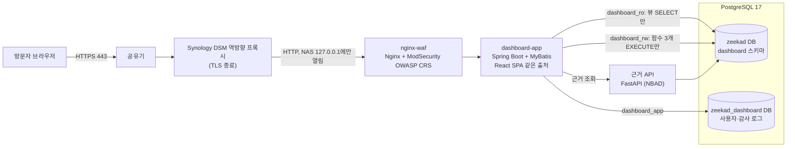
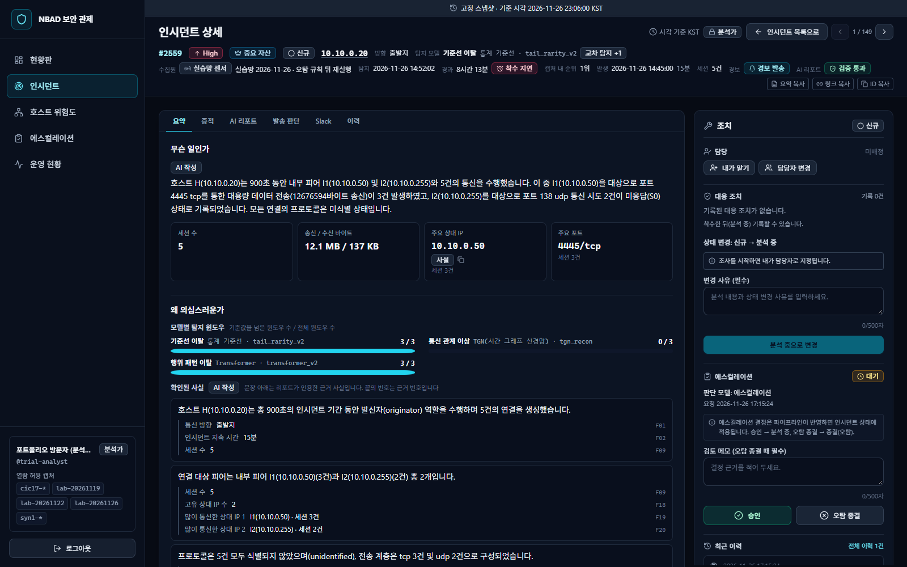
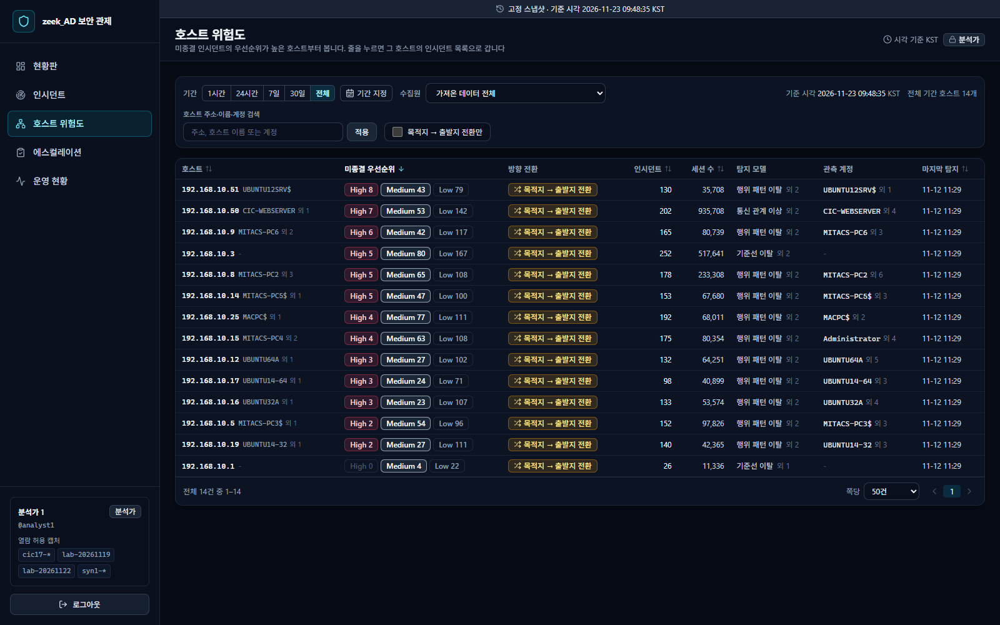
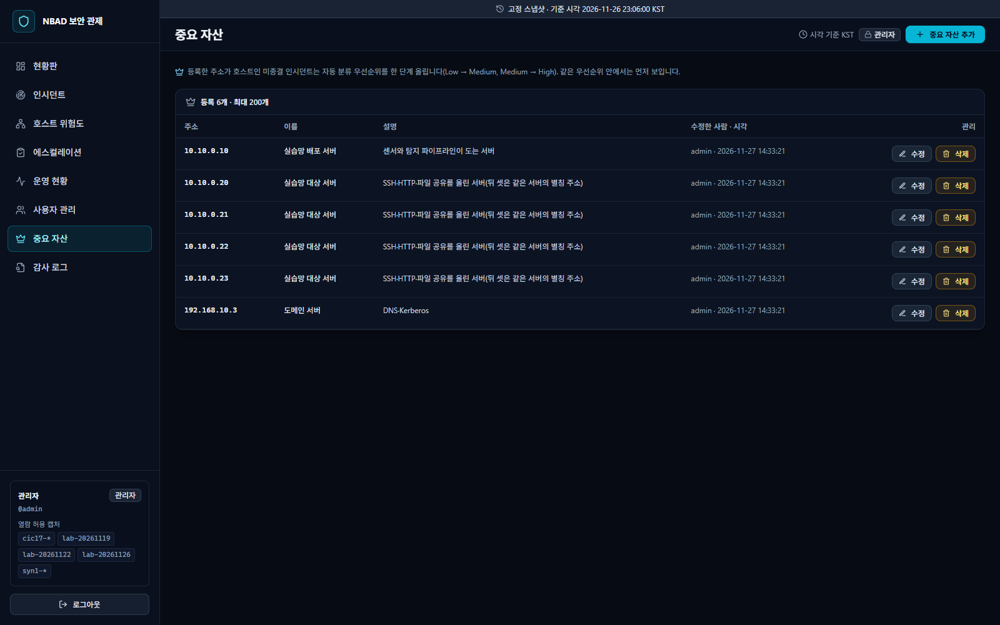
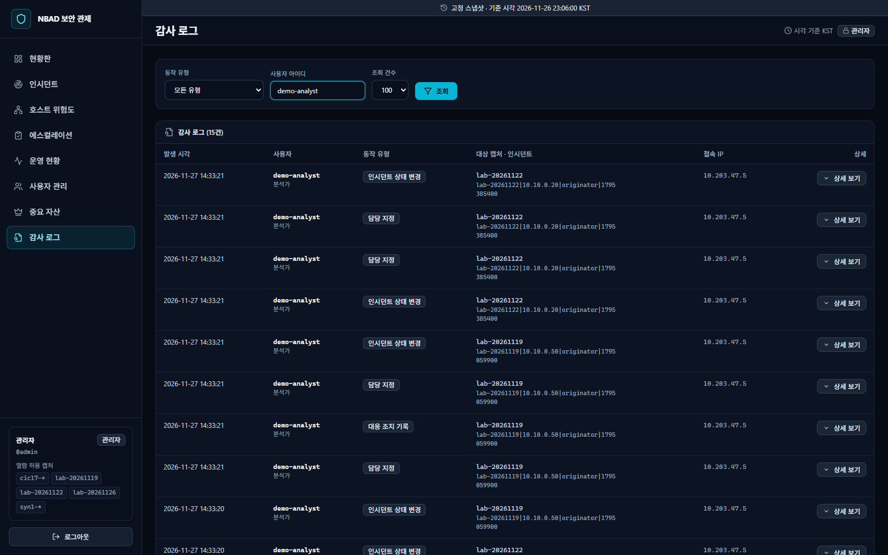

# NBAD 보안 관제 콘솔

네트워크 행동 이상탐지(Network Behavior Anomaly Detection) 파이프라인 [NBAD](https://github.com/prosild/network-behavior-anomaly-detection)가 찾아낸 인시던트를 분석가가 조사하고 판정하는 보안 관제(SOC) 웹 콘솔입니다. 역할별 권한, 캡처 단위 접근 통제, 개인정보 마스킹, 감사 로그를 갖춘 Spring Boot + MyBatis 백엔드와 React SPA로 만들었습니다. 패키지·DB 이름 `zeekad`는 처음 이름(zeek_AD)을 그대로 씁니다.

**공개 데모** https://soc.psdev93.synology.me
- 조회자 `demo` · 비밀번호 `WTYdSaRDUfjT3jr9cAw2` · 읽기 전용, IP 일부 가림
- 분석가 체험 `trial-analyst` · 비밀번호 `xonF89YKMMMBG7nesqS7` · 분류·조사·종결, 에스컬레이션 결정, 담당 지정을 직접 해 볼 수 있습니다. 바꾼 내용은 매시 정각에 되돌립니다.

이 프로젝트에서 내린 판단 몇 가지:
- 처음에는 읽기 전용 계정 하나만 열었습니다. 분석가 흐름을 직접 해 볼 수 있게 체험용 분석가 계정을 더했고 바뀐 내용은 매시 정각에 앱 밖에서 되돌립니다. 앱에는 데모 전용 동작을 넣지 않았습니다. → [판단 1](docs/design-decisions.md#1-공개-데모의-쓰기-권한-2026-11-20-2026-11-22에-바꿈)
- 비밀번호를 공개한 계정은 누구나 잠글 수 있어서 그 계정들(조회자·분석가 체험)만 잠금에서 빼고 IP별 속도 제한으로 막았습니다. 관리자와 다른 계정의 잠금은 그대로 둡니다. → [판단 2](docs/design-decisions.md#2-비밀번호를-공개한-계정의-잠금-문제-2026-11-20-2026-11-21에-바꿈)
- 실제 데이터를 넣어 보니 자동 우선순위가 분류를 못 해서(High가 캡처당 60~120건) 규칙을 다시 정했습니다. → [판단 7](docs/design-decisions.md#7-실제-데이터를-보고-우선순위-규칙을-다시-정했다-2026-11-21)

## 공개 데모 둘러보기

- 데이터는 2026-11-26 23:06:00 KST에 멈춘 고정 스냅샷입니다. 화면의 "최근 24시간"은 이 기준 시각에서 셉니다.
- `demo`는 조회자(`VIEWER`)입니다. IP는 뒤 두 옥텟이 가려지고(`10.10.*.*`), 상태 변경·담당 지정·에스컬레이션 결정은 할 수 없습니다. 볼 수 있는 캡처는 CIC-IDS2017(`cic17-*`), 합성 패턴을 끼운 CIC 데이터(`syn1-*`), Kali 실습망 캡처 셋(`lab-20261119`, `lab-20261122`, `lab-20261126`)입니다.
- `trial-analyst`는 분석가(`ANALYST`)입니다. 볼 수 있는 캡처는 `demo`와 같고 IP가 가려지지 않습니다. 모든 방문자가 같은 계정을 쓰므로 다른 방문자가 바꾼 상태나 적은 사유가 다음 정각까지 보일 수 있습니다. 정각 직후에는 화면을 새로 고쳐 주세요.
- 기본 기간(24시간)에는 실습망 인시던트 9건(`lab-20261126`)만 보입니다. 기간을 **전체**로 넓히면 가져온 데이터까지 2,277건이 보입니다.
- 현황판 **수집원 상태**의 가져온 데이터 줄 끝 **전체 기간**을 누르면 그 캡처의 인시던트를 기간 제한 없이 바로 봅니다(기본 24시간에는 가져온 데이터가 0건이라 줄마다 이 링크가 있습니다).
- 실습망 인시던트에 붙은 빨간 **착수 지연** 표지는 탐지 뒤 착수 목표(High 30분, Medium 4시간, Low 24시간) 안에 아무도 착수하지 않은 건에 붙습니다. 실습망은 탐지 시험용이라 분석이 끝난 예시 셋(아래)을 빼면 대응하는 분석가가 없어 인시던트가 신규로 남아 있고, 기준 시각에 이미 목표를 넘긴 건이 많습니다(전체 기간 145건). 화면의 시간은 기준 시각에 멈춰 있어 표지가 더 늘지는 않습니다. `trial-analyst`로 로그인해 그 건의 상태를 "분석 중"으로 바꾸면 표지가 사라지고 매시 정각 초기화 때 다시 붙습니다. CIC·합성 같은 가져온 데이터는 재생 데이터라 착수 목표를 따지지 않아 표지가 붙지 않습니다.
- `lab-20261122`는 Kali에서 공격 6종(느린 스캔, 비커닝, 분할 유출, SMB 공유 탐색, SSH 무차별 대입, DNS 터널)을 타깃 VM으로 7회 실행한 날의 캡처입니다(인시던트 88건, 그중 Slack 경보 77건). 빠른 스캔과 서비스 스캔은 `lab-20261119`에, 오탐 규칙 뒤 다시 돌린 2회는 `lab-20261126`에 있어 공개 데모의 세 실습망 캡처에 공격 8종 13회(규칙 전 11회, 규칙 뒤 2회)가 있습니다. 상세의 **Slack** 탭에는 그 인시던트의 알림만 보이고 스레드 관계는 표지와 들여쓰기로 나타납니다. 묶음을 연 인시던트에서는 첫 알림이 "최초 알림"이고 같은 인시던트의 뒤 알림은 들여쓴 "후속 알림"입니다. 다른 인시던트가 연 묶음에 붙은 알림은 들여쓴 "다른 인시던트의 후속 알림"으로 보입니다. 그중 채널에도 다시 올린 알림에는 "채널에도 표시" 표지가 붙습니다. 다른 인시던트가 연 묶음 위에는 "최초 알림 인시던트" 링크(뒤에 그 인시던트 번호)가 있어 묶음을 연 인시던트의 Slack 탭으로 갑니다. 묶음에 인시던트가 둘 이상이면 "같은 묶음 인시던트" 링크(뒤에 건수)를 눌러 인시던트 목록에서 그 묶음만 모아 봅니다. 스레드를 기록하기 전(2026-11-19 06:20 UTC 전)의 알림은 같은 인시던트의 첫 알림만 "최초 알림"이고 그 뒤 알림은 "스레드 기록 없음"으로 보입니다(`lab-20261119`와 가져온 데이터). 탐지 결과는 NBAD 저장소의 [실습망 공격 탐지 결과](https://github.com/prosild/network-behavior-anomaly-detection/blob/main/docs/lab-attack-detection.md)에 있습니다. 규칙 전의 기록에서 8종 중 4종을 잡았고, 오탐 규칙을 배포한 뒤 다시 돌린 분할 유출도 잡혔습니다.
- `lab-20261126`은 탐지 파이프라인이 브로드캐스트뿐인 5분 창을 조사 큐에서 빼는 규칙(탐지 저장소 설계 결정 DD-021)을 배포한 뒤, 같은 공격 둘(비커닝, 분할 유출)을 다시 돌린 날의 캡처입니다(인시던트 9건). 리뷰에서 지적받은 브로드캐스트 오탐을 고친 뒤의 모습입니다. 맨 위는 분할 유출을 보내는 쪽입니다.
- 이날 Slack 알림 8건 중 공격에 대한 것은 3건입니다. 나머지 5건은 시작 전 연결 확인과 타깃의 정상 배경 트래픽입니다. 실습망 호스트는 학습 이력이 없는 새 자산이라 정상 활동도 사건이 됩니다(탐지 파이프라인의 알려진 한계).
- 규칙 전후 수치(유휴 3일 271건 → 0건, 공격한 날 88건 → 21건)는 저장된 점수로 큐를 다시 만들어 잰 값입니다. 화면의 `lab-20261122`와 `lab-20261126`은 다른 날의 트래픽이라 화면끼리 직접 견줄 수 없습니다.
- `lab-20261122`의 브로드캐스트 한 건이 High 경보가 된 사건(리뷰에서 지적받은 #2271)은 "규칙 전의 오탐 사례"로 그대로 둡니다. 규칙 뒤라면 사건이 되지 않습니다.
- 기간 버튼 끝의 **기간 지정**에서 시작·끝 시각(KST, 분 단위)을 정하면 그 구간에 탐지된 인시던트만 봅니다. 범위는 주소에 남아 링크로 나눌 수 있습니다. 현황판 탐지 추이에서 막대를 누르면 그 구간의 큐로 갑니다.
- 현황판 아래쪽에는 **ATT&CK 전술·기법 후보**, **위험 호스트 상위 5**, **주요 알림 묶음** 패널이 있습니다. 줄을 누르면 그 조건의 인시던트 목록이 열리고 줄의 건수는 열린 목록의 건수와 같습니다(알림 묶음은 "전체" 건수). ATT&CK 후보는 AI 리포트가 적은 가설이고 확정된 분류가 아닙니다.
- **호스트 위험도** 메뉴는 인시던트를 호스트별로 묶어 미종결 High·Medium·Low 건수가 많은 호스트부터 보입니다. 줄을 누르면 그 호스트의 인시던트 목록으로 갑니다. `demo`에서는 주소가 가려져 있어 한 줄(`10.10.*.*`)이 호스트 하나가 아니라 그 대역의 호스트 전부입니다. 호스트 하나씩 보거나 "목적지 → 출발지 전환" 표지를 보려면 `trial-analyst`로 로그인하세요.
- 인시던트 목록은 호스트(`hostIp`)와 ATT&CK 전술·기법(`attack`) 조건을 받습니다. 호스트 위험도의 줄, 상세 머리줄의 호스트 IP, 현황판 패널의 줄이 이 조건을 붙여 목록을 열고 걸린 조건은 목록 위에 칩으로 보입니다. Slack 알림이 다른 인시던트와 한 스레드로 묶인 행에는 **묶음 N건** 표지가 붙고 누르면 그 묶음의 인시던트만 모아 봅니다. **CSV 내보내기**는 지금 쪽의 행을 내려받습니다.
- 인시던트 상세의 요약 탭 아래에는 **같은 호스트의 다른 인시던트**가 발생 시각이 가까운 순으로 10건까지 나옵니다(`demo`는 같은 대역). 증거 탭의 **주요 통신 구조**는 대상 호스트와 세션이 많은 상대 IP를 다섯까지 선으로 이은 그림입니다. 머리줄의 **요약 복사**는 인시던트 요약을 마크다운으로 복사합니다. 내보내기와 복사는 화면이 이미 받은 값만 쓰므로 `demo`는 가려진 값을 가져갑니다.
- **분석이 끝난 예시**: 인시던트 셋은 시연 분석가(표시 이름 "시연 분석가")가 근거를 보고 판정하고 조치를 기록한 것입니다. 정탐 둘(#2218 SMB 공유 탐색, #2142 포트 스캔)과 오탐 하나(#2271 NetBIOS 브로드캐스트)입니다. 인시던트 목록에서 상태를 "종결", 기간을 "전체"로 두면 보입니다. 상세의 **이력** 탭에 착수 → 담당 → 대응 조치 → 담당 해제 → 종결의 순서와 사유가 남아 있습니다(종결된 인시던트의 담당은 바꿀 수 없어 해제를 종결 전에 했습니다).
- 예시 셋은 실습망에서 직접 실행한 공격 재현이라 정탐으로 닫았지만 차단·격리는 하지 않았고, 대응 조치는 "조치 없음"과 그 사유로 적었습니다. `demo`에게는 사유의 주소가 가려지고 대응 조치는 종류·기록자·시각만 보입니다(메모는 `trial-analyst`로 보입니다).
- #2218에는 "검토 대기" 표시가 남아 있습니다. 앞선 탐지 작업이 올린 에스컬레이션 요청이 결정되지 않은 채 남은 것이고 인시던트 종결과 따로 기록됩니다(에스컬레이션 목록에는 나오지 않습니다).
- 종결된 인시던트는 분석가가 사유를 적어 **다시 열** 수 있습니다. 상태는 분석 중으로 돌아가고 앞선 종결과 판정은 이력에 남습니다. 정탐으로 종결하려면 **대응 조치**(IP 차단, 호스트 격리, 계정 잠금, 이관, 모니터링 강화, 조치 없음, 기타)를 하나 이상 기록해야 합니다. 대응 조치는 기록만 하고 방화벽·EDR에 명령을 내리지 않습니다.
- 우선순위 옆의 **중요 자산** 표지는 관리자가 등록한 서버의 인시던트에 붙습니다. 그 인시던트는 한 단계 올라가고(Low → Medium, Medium → High) 같은 우선순위 안에서 먼저 옵니다. `demo`에는 이유(툴팁)만 보이고 자산 이름은 보이지 않습니다.

처음 보실 때 권하는 순서:
1. **현황판**: 기간을 "전체"로 바꾸면 탐지 추이와 수집원 상태, 그 아래 위협 패널 셋이 보입니다.
2. **인시던트**: 우선순위 High부터 정렬된 큐입니다. 착수 목표를 넘긴 건에는 "지연" 표지가 붙습니다.
3. 인시던트 하나를 열어 **요약 → 증거 → AI 리포트 → 발송 판단** 탭 순서로 봅니다.
4. 인시던트 목록에서 상태를 **종결**, 기간을 **전체**로 바꾸면 분석이 끝난 예시 셋이 나옵니다. #2218을 열어 **이력** 탭에서 착수부터 종결까지의 사유와 대응 조치를 봅니다.
5. **호스트 위험도**: 기간을 "전체"로 바꾸면 먼저 볼 호스트가 위에 옵니다.
6. **운영 현황**: 분석가 판정 집계, 처리 시간(MTTD·MTTA·MTTR), 탐지 작업 기록입니다. 판정 집계와 처리 시간에는 예시 셋이 전체 기간에만 들어갑니다(기록 시각이 스냅샷 기준 시각 뒤라 처리 시간이 며칠로 보입니다).

## 무엇을 만들었나

NBAD는 Zeek 네트워크 로그를 여러 이상탐지 모델로 채점하고 인시던트마다 AI 분석 리포트와 경보 발송 판단을 만드는 파이프라인입니다. NBAD도 제가 만든 프로젝트이고 이 저장소는 그 결과를 사람이 조사하고 판정하는 쪽을 맡습니다.

- 대시보드는 NBAD의 DB(`zeekad`)를 **읽기 전용 뷰**로만 읽습니다. 쓰기는 NBAD가 제공하는 DB 함수 세 개(인시던트 상태 변경, 에스컬레이션 결정, 종결 건 다시 열기)를 부르는 것뿐입니다.
- 대시보드 자신의 데이터(사용자, 담당자, 인시던트 번호, 감사 로그)는 같은 PostgreSQL 안의 별도 DB에 둡니다.
- 인시던트 상세의 증거는 NBAD의 근거 API(FastAPI)에서 받아 백엔드가 권한 검사와 마스킹을 거친 뒤 보냅니다.



공개 데모의 구성은 [`compose.portfolio.yml`](compose.portfolio.yml)이고 VMware 실습 환경(NBAD와 같은 VM) 구성은 [`compose.yml`](compose.yml)입니다.

## 역할별 화면

조회자 화면은 공개 데모와 같습니다. 분석가·관리자 그림은 공개 데모와 같은 스냅샷을 복원한 로컬 스택에서, 그 스택에서만 켠 계정으로 찍었습니다.

**조회자** (공개 데모 `demo`와 같은 화면)

| 현황판 | 인시던트 큐 |
|---|---|
|  |  |


**분석가**: 인시던트를 맡고(담당 지정), 상태를 바꾸고, 한 대응 조치를 기록하고, 파이프라인이 넘긴 에스컬레이션을 승인하거나 오탐으로 종결합니다. 종결한 건은 사유를 적어 다시 엽니다. 분석가는 IP 원문을 보고 원문 열람은 감사 로그에 남습니다.

| 인시던트 상세와 조치 패널 | 에스컬레이션 목록 |
|---|---|
|  |  |

분석가의 호스트 위험도 화면은 호스트 주소 하나가 한 줄입니다(그림은 가져온 데이터만 건 것). 조회자에게는 같은 화면이 대역(`A.B.*.*`) 단위 줄로 보이고 관측 계정은 첫 글자만 남습니다. 중요 자산으로 등록한 호스트에는 표지가 붙습니다.



**관리자**: 비밀번호 다음에 TOTP 2단계 인증을 거쳐야 업무 API가 열립니다. 사용자의 역할과 열람 허용 캡처, 중요 자산을 관리하고 보관 기한 안에는 수정·삭제할 수 없는 감사 로그를 봅니다.

| TOTP 2단계 인증 | 중요 자산 관리 | 감사 로그 |
|---|---|---|
|  |  |  |

## 주요 판단

자세한 고려 안과 근거는 [주요 판단 기록](docs/design-decisions.md)에 있습니다.

| 문제 | 고른 것 | 그 대가 |
|---|---|---|
| 공개 인터넷에서 쓰기 권한을 열면 누구나 데이터를 바꾼다 | 체험용 분석가 계정을 열고 바뀌는 표 셋을 앱 밖 서비스가 매시 정각에 기준선으로 되돌림(전용 DB 계정은 초기화 함수와 보관 기한 삭제 함수만 실행) | 방문자끼리 상태를 공유하고 다른 방문자의 글이 최대 1시간 보인다. 감사 로그는 보관 기한(90일) 동안 쌓인다 |
| ZAP "Low 0" 기준과 JS가 읽어야 하는 CSRF 쿠키(HttpOnly 없음)가 충돌 | 정확히 `XSRF-TOKEN`에 대한 경고만 기계적으로 허용, 남은 위험으로 문서화 | 기준에 예외가 하나 생긴다. 규칙 전체를 끄면 다른 쿠키의 누락을 놓친다 |
| 처음 만든 서버 렌더링 화면을 직접 보니 디자인이 마음에 들지 않았다 | React SPA로 바꾸되 같은 출처 세션·CSRF·엄격한 CSP·JRE 컨테이너 하나를 유지 (Next.js는 Node 런타임이 늘어 기각) | 보안 시험을 SPA 기준으로 전면 다시 썼다 |
| 대시보드가 뚫려도 파이프라인 데이터는 바뀌면 안 된다 | 같은 PostgreSQL 안의 별도 DB와 계정 셋(앱·읽기·쓰기 함수 전용) | 데이터 소스가 셋이고 새 쓰기는 NBAD 함수가 먼저 있어야 한다(다시 열기가 그 예) |
| 상세 화면에 리포트 생성 정보·토큰·원본 페이로드까지 다 보였다 | 관제 판단·조치에 쓰는 정보만 남기고 용어를 관제 표준 용어로 | 파이프라인 디버깅 정보는 화면에서 바로 못 본다 |
| 다시 빌드해도 안 고쳐지는 WAF 취약점, 로그인 전 XML 본문으로 닿음 | 기반 이미지를 digest로 고정하고 `libxml2`만 하한으로 올림 | 기반 판은 직접 올리고, 상류가 고치면 그 줄을 지워야 한다 |
| 같은 Docker 네트워크의 컨테이너가 전달 헤더로 감사 로그 IP를 꾸밀 수 있었다 | WAF 주소를 고정. 앱은 그 주소에서 온 전달 헤더만, WAF는 DSM 경로에서 온 것만 믿음. 뒤에 네트워크를 둘로 나누고 모든 컨테이너에서 capability를 뺌 | 서브넷을 바꾸면 고정 주소도 같이 바꿔야 한다. 호스트의 프로세스나 WAF 네트워크에 새로 붙인 컨테이너가 패킷 출처를 꾸미는 것은 못 막는다 |

## 보안 설계

| 통제 | 내용 | 근거 |
|---|---|---|
| 역할 기반 권한 | 조회자(읽기)·분석가(상태 변경·담당·에스컬레이션 결정)·관리자(사용자·감사 로그) | `config/SecurityConfig.java`, 시험 `TotpAndRbacIntegrationTest` |
| 객체 수준 접근 통제 | 사용자별 열람 허용 캡처 패턴을 모든 조회에서 검사. 허용 밖과 없는 대상은 같은 `403`으로 답하고 IDOR 시도로 감사 | `service/CaptureAccessService.java`, 시험 `IdorAndMaskingIntegrationTest`, `T27IncidentNoIntegrationTest` |
| 개인정보 마스킹 | 조회자에게 IP 뒤 두 옥텟, 계정 이름, 리포트 가명 대응을 가림. 분석가 이상의 원문 열람은 감사. 중요 자산은 조회자에게 표지와 기본 우선순위만 보이고 이름은 내리지 않음(설명은 어떤 인시던트 응답에도 없음) | `service/MaskingService.java`, 시험 `MaskingServiceTest` |
| 관리자 2단계 인증 | 관리자는 TOTP 검증 전까지 업무 API가 `403`. 틀린 코드는 감사에 남고 비밀번호 실패와 합쳐 5회에 계정이 잠긴다(코드를 보기 전에 시도를 차지해 동시 요청도 한도를 넘지 못한다) | `security/TotpEnforcementFilter.java`, `security/FailedAttemptService.java`, 시험 `T60TotpFailureLimitIntegrationTest` |
| 계정 잠금 | 5회 실패(비밀번호와 관리자 TOTP 코드를 합쳐 셈)에 15분 잠금. 비밀번호를 공개한 두 계정(조회자·분석가 체험)만 설정으로 제외하고 IP별 로그인·TOTP 확인 속도 제한(분당 10회, 버스트 5)이 막는다 | `security/DashboardAuthenticationProvider.java`, 시험 `T29LockoutExemptIntegrationTest`, `compose.portfolio.yml` |
| 세션·CSRF | 서버 세션(유휴 30분·절대 8시간), 쿠키 `Secure; HttpOnly; SameSite=Lax`, SPA 이중 제출 CSRF | `security/SessionTimeoutFilter.java`, `security/SpaCsrfTokenRequestHandler.java`, 시험 `SecurityAuthSessionTest` |
| 응답 헤더 | CSP `script-src 'self'; style-src 'self'`(인라인 금지), `frame-ancestors 'none'`, `nosniff`, COOP·COEP·CORP | `config/SecurityConfig.java`, 시험 `SecurityHeadersAndErrorTest` |
| WAF | Nginx + ModSecurity OWASP CRS(Paranoia 1, 차단 모드). SQLi·XSS·경로 탐색 요청을 앱 앞에서 `403`. 감사 줄에는 접속 주소·시각·요청 주소·응답 코드·걸린 규칙만 남기고 요청·응답의 헤더와 본문은 남기지 않음(세션 쿠키·CSRF 토큰이 남던 것을 고침) | `docker/nginx-waf/`, `scripts/waf-audit-log-check.ps1`, [보안 검증 보고서](docs/security-verification-report.md) 3절 |
| 클라이언트 IP 위조 방지 | 신뢰하는 프록시 밖의 전달 헤더를 버리고 앱에는 WAF가 정한 값만 넘김. 앱은 WAF 고정 주소에서 온 전달 헤더만 믿음 | `docker/nginx-waf/templates/includes/proxy_backend.conf.template`, `security/TrustedProxies.java`, E2E `[9]`·`[16]` |
| 감사 로그 | 로그인·원문 열람·상태 변경·권한 변경·IDOR 시도를 기록. DB 트리거가 수정을 막고 삭제는 보관 기한이 지난 기록만 전용 함수로 허용(공개 데모 90일) | `V1__init_dashboard_auth_audit.sql`, `V4__audit_retention.sql`, 시험 `AuditLogImmutabilityTest`, `scripts/audit-retention-check.ps1` |
| SQL 주입 방지 | MyBatis 매퍼는 `#{}` 바인딩만 쓰고 `${}`는 시험이 금지 | 시험 `StaticSecurityAndConfigTest` |
| 신뢰하지 않는 글자열 | 호스트·사용자 이름과 LLM 리포트 글을 바깥 입력으로 다룬다. 서버는 숨은 문자(방향 전환·제어·보이지 않는 문자)를 분석가에게는 `[U+202E]` 같은 표지로 보이고 조회자에게서는 지운 뒤 가리며 칸마다 길이 상한(이름 256자 등)을 둔다. 화면은 이름 칸의 폭을 정하고 요약 탭의 리포트 글마다 "AI 작성" 표지를 붙인다. CSV·마크다운 내보내기는 같은 표지 처리와 수식·마크다운 기호 방어를 한 번 더 한다 | `service/UntrustedText.java`, `frontend/src/utils/hiddenChars.ts`, `frontend/src/utils/incidentExport.ts`, 시험 `T63UntrustedTextIntegrationTest`, `t64UntrustedText.test.tsx` |
| DB 계정 분리 | 읽기 계정은 계약 뷰 `SELECT`만, 쓰기 계정은 함수 세 개 `EXECUTE`만 | [`docs/deployment-guide.md`](docs/deployment-guide.md) 2.1 |
| 네트워크 분리 | 공개 스택은 네트워크가 둘이다. 인터넷 요청을 받는 WAF는 앱과만 같은 네트워크에 있고 DB·근거 API·초기화 도구는 내부 전용 네트워크에 있어 WAF에서 DB와 근거 API에 닿지 않고 인터넷으로 나가지 못한다. 다만 공개 데모 NAS의 Docker는 이 네트워크에도 호스트로 가는 경로를 넣어 NAS 자신의 주소에는 닿는다 | `compose.portfolio.yml`, 리허설 `[T61a]`~`[T61c]`, 공개 확인 `[T61a]`(NAS), 시험 `StaticSecurityAndConfigTest` |
| 컨테이너 | 비루트 실행, 최종 이미지에 Node·JDK 없음(JRE만). 공개 스택의 모든 서비스와 VMware 구성의 두 서비스가 `cap_drop: [ALL]`·`no-new-privileges`로 돌고 공개 스택의 DB도 root로 시작하지 않는다 | `Dockerfile`, `compose.portfolio.yml`, `compose.yml`, 리허설 `[T61d]` |

## 검증

| 검증 | 방법 |
|---|---|
| 단위·통합·정적 보안 시험 | Gradle `check`(Spring Boot 통합 시험, MyBatis 매퍼 시험, 보안 설정 정적 검사), Vitest(화면 용어 회귀, XSS, 숨은 문자·긴 이름·내보내기 방어, 접근성 이름) |
| E2E | VMware 구성과 같은 PostgreSQL 17 + WAF 스택을 띄워 역할별 권한·IDOR·마스킹·WAF 차단·전달 헤더 위조를 실제 요청으로 확인 (`scripts/security-scan.ps1`) |
| 취약점·설정 스캔 | OWASP ZAP 베이스라인, Trivy(SBOM·파일 시스템·이미지), CycloneDX SBOM |
| 공개 스택 리허설 | 공개 데모와 같은 구성에 스냅샷을 복원해 E2E와 ZAP을 돌린 뒤 지운다 (`scripts/portfolio-verify.ps1`) |
| 공개 주소 확인 | 배포 뒤 공개 주소에서 로그인·마스킹·숨김 캡처 `403`·속도 제한 등을 확인 |

최근 결과(2026-11-27, commit `fba13ba`): E2E 통과, ZAP High·Medium·Low 0(`XSRF-TOKEN` 예외 제외), 공개 스택 리허설 통과(commit `ccb314a`, 같은 날), 볼륨을 지우지 않는 제자리 갱신 예행 통과, 공개 주소 확인 327항목 중 326 통과(남은 하나는 반영 뒤 감사 삭제 줄인데, 제자리 갱신이라 반영 때 실행한 초기화 결과로 따로 확인). 내부 전용 네트워크는 인터넷으로 나가지 못함을 확인했습니다. NAS 호스트 주소에 닿는 것은 받아들인 남은 위험으로 기록했고, NoNewPrivs는 커널이 표시하지 않아 Docker 설정으로 확인했습니다. 반영 뒤 정각 초기화는 따로 확인해 OK였습니다. Trivy 결과와 남은 위험은 [보안 검증 보고서](docs/security-verification-report.md)에 있습니다.

## AI와 일한 방식

코드와 문서 초안은 AI 코딩 에이전트가 썼습니다(대부분 Claude Code. 2026-11-25 작업의 설계와 초안 일부는 Antigravity와 Codex 세션이 시작했고 사용 한도로 멈춘 뒤 Claude Code가 이어받았습니다). 커밋에 공동 작성 표시가 붙은 것도 그래서입니다. 저는 무엇을 만들지와 어떻게 받아들일지를 맡았습니다.

- **AI에게 맡긴 것**: 구현, 시험 작성, 문서 초안, 맥락 없이 결과물을 읽고 빈틈을 찾는 검토. 설계 안과 트레이드오프 정리, 작업별 인수 조건과 검증 명령의 초안도 AI가 썼습니다.
- **제가 정하고 확인한 것**: 요구와 우선순위, AI가 낸 안 중 무엇을 고를지(되묻거나 바꾸게 한 것 포함), 공개 범위와 보안 정책, 인수 조건과 검증 기준의 승인, 화면 직접 확인, 결과 수락.
- **받아들이는 기준**: 작업마다 미리 정한 시험·E2E·스캔을 통과해야 받아들였습니다. 처음에는 모든 작업에 같은 무거운 검증을 돌렸습니다. 구현 36분에 검증·검토·배포가 약 60분 드는 것을 보고 2026-11-22부터 위험에 따라 나눴습니다. DB 구조·인증·권한·배포 설정을 바꾸는 작업만 E2E 보안 스캔을 돌리고(공개 스택 구성이 바뀌면 리허설도), 화면·문서 작업은 단위 시험과 화면 확인으로 끝냅니다.
- 관제 실무 경험이 없는 부분은 제 요구가 실제 관제 관행과 다르면 AI가 지적하게 하고 근거를 확인한 뒤 고쳤습니다.
- 화면을 직접 보다가 방향을 바꾼 일도 있습니다. 처음 만든 화면의 디자인이 마음에 들지 않아 보안 관제실 느낌의 React SPA로 다시 만들었고([판단 4](docs/design-decisions.md#4-서버-렌더링에서-react-spa로-바꾸면서-지킨-것-2026-11-19)), 공개 데이터에서 Kali 실습망 공격 결과가 빠진 것을 보고 데이터를 배포 VM 스냅샷으로 바꿨고(`T22`), 인시던트 상세에 관제 판단에 쓰지 않는 정보가 많다고 보고 덜어 냈습니다([판단 8](docs/design-decisions.md#8-관제-실무-기준으로-화면을-덜어-냈다-2026-11-21)).

## 기술 스택

- 백엔드: Java 17, Spring Boot 3.5, Spring Security, MyBatis 3.5, PostgreSQL 17 (Flyway)
- 프론트엔드: React 19, TypeScript, Vite, Tailwind CSS, Vitest
- 인프라: Docker Compose, Nginx + ModSecurity(OWASP CRS), Synology DSM 역방향 프록시
- 보안 검증: OWASP ZAP, Trivy, CycloneDX SBOM

## 로컬 실행

NBAD 파이프라인 DB(`zeekad`)가 필요합니다. 환경 변수, 이미지 빌드, NBAD와 함께 띄우는 방법은 [배포 및 운영 가이드](docs/deployment-guide.md) 3·4절에 있습니다. 외부 DB 없이 임시 PostgreSQL 17로 전체 보안 검증을 돌리려면 다음을 실행합니다.

```powershell
powershell -NoProfile -ExecutionPolicy Bypass -File scripts/security-scan.ps1 -EvidenceDir "build/security-evidence"
```

## 문서

- [주요 판단 기록](docs/design-decisions.md)
- [변경 기록](docs/changelog.md): 코드와 시험 이름에 나오는 작업 번호(`T01`~`T68`)
- [배포 및 운영 가이드](docs/deployment-guide.md): VMware 실습 환경
- [포트폴리오 공개 배포 안내서](docs/portfolio-deployment.md): 공개 데모(Synology NAS)
- [보안 검증 보고서](docs/security-verification-report.md)
- [화면 용어 변경 기록](docs/ui-terminology.md)

## 아쉬운 점과 다음에 할 것

- 공개 데모의 전체 기간 인시던트 목록 응답이 최대 482ms입니다(공개 주소 측정). 목록 요청 하나에 같은 질의를 서너 번 돌리던 것을 한 번으로 줄여 로컬 리허설 스택에서는 340ms → 165ms가 됐습니다. 새 스냅샷에서 목록이 약 3배 느려진 것을 계약 뷰용 인덱스 하나로 되돌렸습니다(로컬 663 → 137ms).
- 호스트 위험도의 "목적지 → 출발지 전환" 표지는 같은 캡처 안에서 순서만 보고 시간 간격을 보지 않습니다. 공개 데이터셋에서는 호스트 14개 모두에 붙어 먼저 볼 호스트를 가려내는 데 도움이 되지 않습니다.
- 공개 스택은 네트워크를 둘로 나누고 모든 컨테이너에서 capability를 빼서 스택 안의 컨테이너가 패킷 출처를 꾸밀 수 없습니다. 호스트의 프로세스와 WAF 네트워크에 나중에 새로 붙인 컨테이너는 여전히 막지 못하고, `api`·초기화 도구는 앱에 직접 닿습니다(앱이 그 연결의 전달 헤더를 믿지 않습니다).
- Spring Framework 6.2.19에 CRITICAL 취약점 2건이 남아 있습니다. 해당 기능(`XsltView`, SSE 뷰)을 쓰지 않아 노출 경로는 없고 고친 버전이 Spring Boot 4 세대라 그때 해소합니다.
- 대응 조치는 기록만 합니다. 방화벽·EDR에 명령을 내리지 않고, 시각은 조치한 시각이 아니라 기록한 시각입니다.

## 데이터 출처

- **CIC-IDS2017**: Canadian Institute for Cybersecurity(University of New Brunswick)의 공개 데이터셋입니다. https://www.unb.ca/cic/datasets/ids-2017.html
  > Iman Sharafaldin, Arash Habibi Lashkari, and Ali A. Ghorbani, "Toward Generating a New Intrusion Detection Dataset and Intrusion Traffic Characterization", 4th International Conference on Information Systems Security and Privacy (ICISSP), Portugal, January 2018.
- **합성 패턴(`syn1-*`)**: CIC-IDS2017 Zeek 로그 사본에 합성 패턴 5종(beacon, 느린 유출, DNS 터널, 측면 이동, 느린 정찰)을 코드로 끼워 넣은 데이터입니다. 네트워크로 보낸 트래픽이 아닙니다(NBAD [DD-008](https://github.com/prosild/network-behavior-anomaly-detection/blob/main/docs/design-decisions/DD-008-synthetic-apt-injection.md)).
- **실습망(`lab-20261119`, `lab-20261122`, `lab-20261126`)**: 격리된 실습망에서 Kali Linux로 공격하고 배포 VM이 직접 수집한 트래픽입니다. `lab-20261119`는 정상 배경 트래픽을 섞었고 `lab-20261122`는 타깃 VM을 두고 공격 6종을 7회 실행했습니다(빠른 스캔·서비스 스캔은 `lab-20261119`). `lab-20261126`은 오탐 규칙(DD-021)을 배포한 뒤 비커닝과 분할 유출을 다시 실행했습니다.

이 데이터를 NBAD 파이프라인이 분석한 결과를 보여 줍니다.
